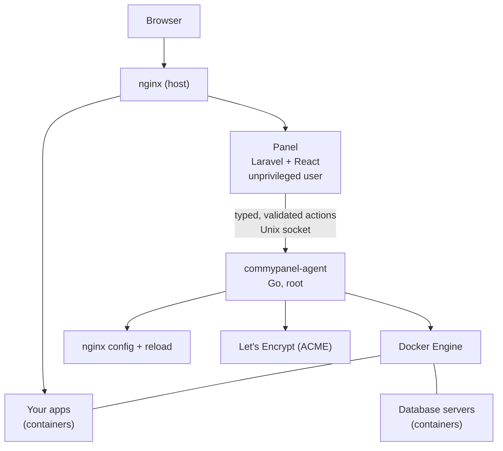

# Architecture

## The parts

### The panel

A Laravel and React application with its own small **SQLite** databases (one for app data, one for the queue, one for cache and sessions). It runs on the host under systemd, as the unprivileged `commypanel` user, behind nginx. It decides *what* should happen; it never runs a privileged command itself and never touches the Docker socket. Long work (builds, deployments, certificate requests, database provisioning) runs as **queued jobs** with persisted status and logs, never inside a web request.

### The agent

`commypanel-agent` is a small Go program that runs as root. It listens only on a **Unix socket** that the `commypanel` user can use, never on the network, and it checks who is calling. It accepts a **fixed list of typed actions** (run a container, write an nginx site, request a certificate, create a database, ...), validates every input against allow-lists on its own, runs commands as argument lists and never through a shell, and renders configuration from templates. It has no database and no business logic. See [Security](security.md).

### nginx

nginx runs on the host (not in a container), so domains, certificates and the panel keep working while Docker is down. The agent writes one site per app from validated fields and applies it only if `nginx -t` passes, then reloads gracefully.

### Docker

Your apps and databases run as containers from images built on the server (apps) or official images (databases). Each app has its own network. See [Containers and networks](../apps/networks.md).

## Why the panel does not run in Docker

If Docker crashes or is being repaired, the panel must stay up so you can see the problem, restart Docker and redeploy. Docker is a dependency the panel manages, never one it lives inside. For the same reason the panel's own database never lives in a database container.

## Where things live

| What | Where |
|---|---|
| Panel code | `/opt/commypanel/releases/<version>` (owned by root, read-only to the panel) |
| Panel data: databases, builds, volumes, backups | `/var/lib/commypanel` |
| Agent state: TLS keys, certificates, scratch files | `/var/lib/commypanel-agent` (root only) |
| Settings and the panel's certificate | `/etc/commypanel` |
| Per-app nginx sites | `/etc/nginx/commypanel` |
| Agent socket | `/run/commypanel/agent.sock` |

See [Ports and paths](../reference/ports-and-paths.md) for the full list.

## One server

CommyPanel manages the one machine it is installed on. There is no multi-server mode, no Swarm and no Kubernetes, and none is planned.
