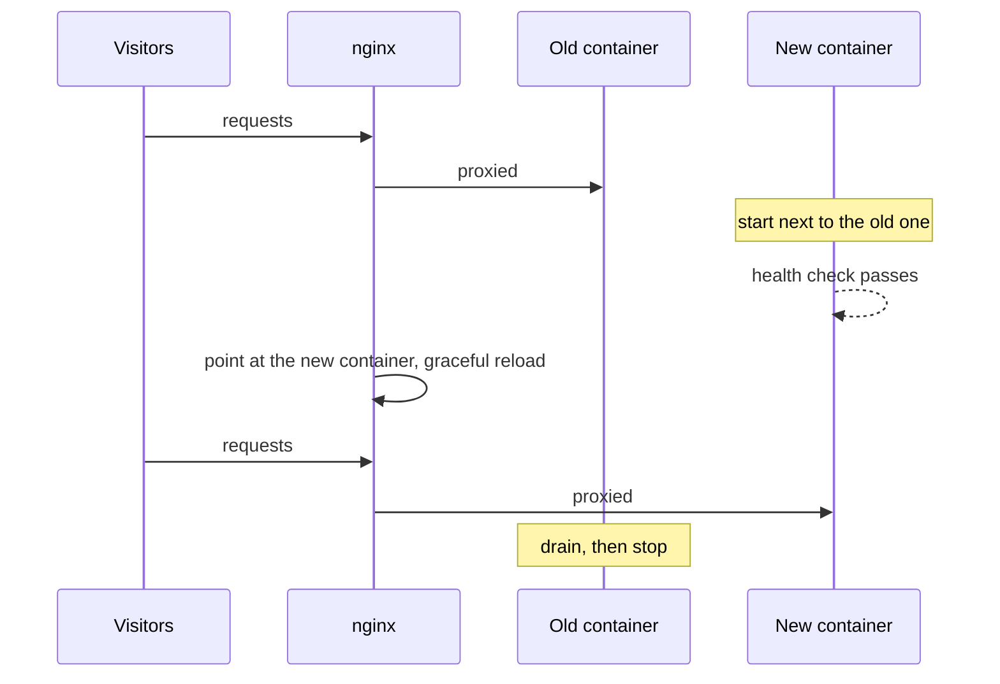

# Zero-downtime deployments

Every deployment, rollback and [apply changes](../apps/lifecycle.md#applying-changes-without-a-deployment) uses the same **blue/green** switch, so visitors never see a gap.

1. **Build** the new image (or reuse one, for a rollback or apply). The old version keeps serving.
2. **Start** the new container on a different local port, on the app's own network, with the app's variables, volumes and links.
3. **Health check**: CommyPanel asks the health check path until the app answers (anything below 500), for up to 60 seconds (`DEPLOY_HEALTH_TIMEOUT`).
4. **Switch**: nginx's upstream is rewritten and reloaded **gracefully**, which does not drop open connections.
5. **Drain**: the old container keeps running for a few seconds (10 by default, `DEPLOY_DRAIN_SECONDS`) so in-flight requests finish, then it stops.

## If something fails

At any step before the switch, **the old container keeps serving** and nothing changes: a failed build, a failing [release command](../apps/release-command.md), a container that does not start, or a health check that never passes. The deployment is marked failed with the reason, and the new container is removed.

## What your app has to tolerate

- **Two versions run at once for a moment.** The old and the new container share the same [volumes](../apps/volumes.md) and the same databases, so a change must work with both versions. This matters most for database migrations: write them so that the old version still works after they run.
- **State belongs outside the container.** Anything an app writes inside its container is lost when the container is replaced. Use a database, external storage or a persistent volume.
- **Answer your health check** when the app is really ready, not before. A health check that passes too early sends traffic to a container that cannot serve it yet.
- **Handle shutdown signals**: finish requests, then exit.

## What it does not do

It does not roll back volume data or databases, and it does not make a broken app healthy. If the new version starts but misbehaves in ways the health check cannot see, CommyPanel [watches it after the switch](../apps/safe-deployments.md) and rolls back by itself when it is clearly worse; you can also roll back from the **Deployments** tab, or release it to your visitors [gradually](../apps/safe-deployments.md#gradual-rollout).
