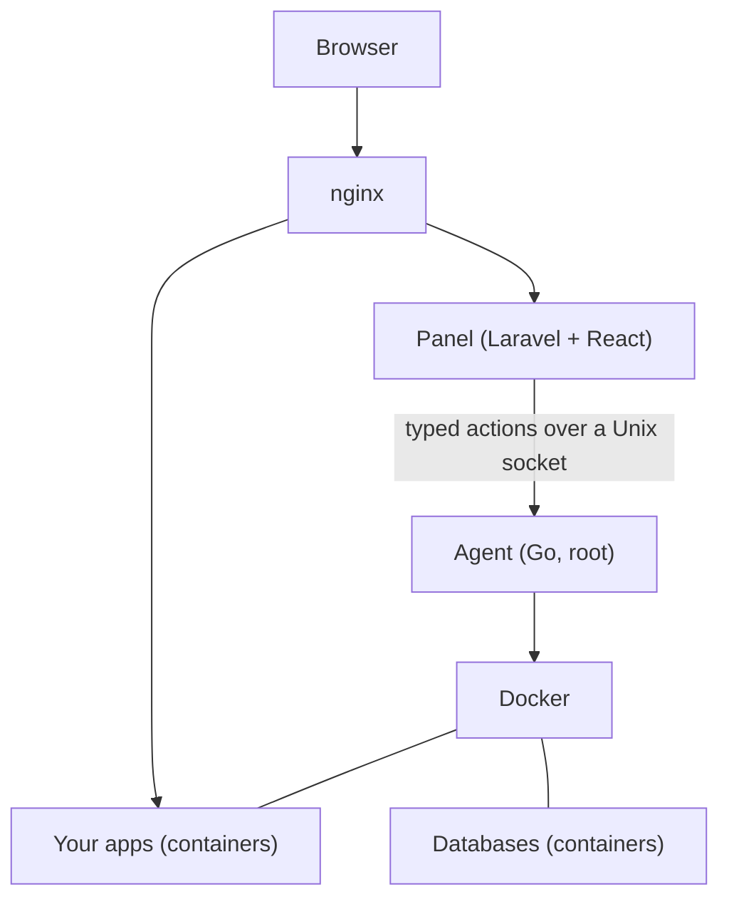

# What is CommyPanel?

CommyPanel is an open-source, self-hosted **server control panel**. You install it on a server you own, and from its web interface you can:

- **Deploy apps** from a Git repository (or a zip) with **zero downtime**: .NET, Go and Node apps get a Dockerfile generated for them, and any app with its own Dockerfile works too.
- **Connect domains**: it shows you which DNS records to create, checks them, and issues and renews **Let's Encrypt** certificates.
- **Run databases**: PostgreSQL, MySQL and MariaDB in containers, linked to your apps over private networks, backed up nightly, and opened in phpMyAdmin or pgAdmin with one click, or opened to chosen IP addresses on the internet for a limited time, with TLS.
- **Deploy safely**: the new release is watched after it goes live and rolled back by itself if it is clearly worse, and you can roll it out to your visitors [gradually](apps/safe-deployments.md).
- **Operate it safely**: users, roles and permissions, two-factor authentication, an audit log you can filter and search, API tokens for your pipelines, and messages to Slack or Discord when a deployment finishes.

:::warning Under heavy development
CommyPanel is **pre-1.0**. Things change between releases and it has only been run on a small number of servers. Use it for side projects and test servers first, keep backups of anything that matters, and read the [known limitations](known-limitations.md) before you trust it with production.
:::

## Who it is for

You have **one server** (a VPS, a dedicated machine, a home server) and you want to run a handful of services on it without hand-writing nginx files, systemd units and certificate scripts. Most of what you run is a web app or API plus a database.

It is a good fit if you:

- run .NET, Go or Node services, or anything you can put in a Dockerfile,
- want deployments that never drop a request,
- prefer a small panel that keeps working when Docker does not,
- care that the privileged part of the system is small and auditable.

It is **not** a good fit if you need several servers, Docker Compose, preview environments per pull request or a catalog of one-click services. See the [FAQ](faq.md#how-is-commypanel-different-from-coolify) for an honest comparison with Coolify.

## How it works in one minute

The **panel** is the web interface. It runs as an unprivileged user directly on the host, not in Docker. Everything that needs root goes through a small program, the **agent**, that accepts a fixed list of validated actions. Your **apps and databases** run in Docker containers, with nginx in front. Read more in [Architecture](concepts/architecture.md).

## Where to go next

- [Install it](getting-started/install.md) on a server (one command).
- [Deploy your first app](getting-started/first-app.md).
- Learn how [zero-downtime deployments](concepts/zero-downtime.md) work.
- Look up a [command](reference/cli.md), a [setting](reference/configuration.md) or a [permission](reference/permissions.md).
